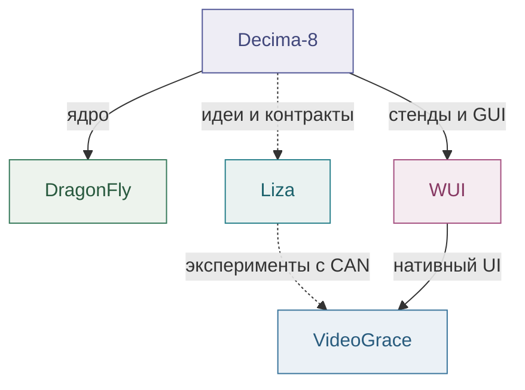

# Intent Garden

**Вычисления, язык, интерфейсы и связь.** Связанные проекты Intent Garden / Rulerom,
в которых исследовательские идеи проверяются инструментами и реальными приложениями.

[Карта экосистемы](https://intent-garden.org/ru/) · [English](https://intent-garden.org/en/) · [Rulerom](https://github.com/rulerom)

Линии показывают разные связи: применение ядра, инструменты и обмен идеями.
Пунктиром отмечены идеи и экспериментальные интеграции.

| Проект | Роль и текущее состояние | Точка входа |
| --- | --- | --- |
| **Decima‑8** | Нейроморфная архитектура и исполняемое C-ядро: тайлы, сигналы, явное состояние. Исследовательская основа и стенды. | [Документация](https://decima.rulerom.com/) |
| **DragonFly** | Бинокулярный зрительный стенд на двух независимых ядрах Decima‑8. Исследуем малые движущиеся цели; реальная камера и аппаратный полёт ещё не проверены. | [Описание](https://intent-garden.org/ru/#project-dragonfly) |
| **Liza** | Экспериментальный системный язык для сетевых сервисов: эффекты, владение, контроль ресурсов, нативная компиляция через LLVM. | [Документация](https://liza.rulerom.com/) · [Код](https://github.com/rulerom/liza) |
| **WUI** | C++17-библиотека интерфейсов для Windows/Linux с экспериментальными macOS/WASM backend. Используется в нативном VideoGrace и инструментах Decima. | [Код и релизы](https://github.com/intent-garden/wui) · [Сайт](http://libwui.org/) |
| **VideoGrace** | Прикладной продукт: видеоконференции, мессенджер, записи, расшифровка, перевод и саммари встреч. | [Сайт продукта](https://videograce.ru/) |

## Как проекты помогают друг другу

- **Decima → DragonFly:** конкретная задача восприятия позволяет исследовать
  вычислительную модель и измерять ограничения ядра.
- **Liza → VideoGrace:** CAN даёт языку практический сетевой сценарий.
  Экспериментальный worker уже выполнил задачу на настоящем сервере; текущий
  сервер VideoGrace не объявляется переписанным на Liza.
- **WUI → VideoGrace:** общий нативный UI проверяется в рабочем приложении.
  Проблемы с потоками, устройствами и отрисовкой возвращаются исправлениями в библиотеку.

Проекты развиваются в нескольких репозиториях и организациях. Доступность исходников,
лицензии и границы поддержки определяются отдельно в каждом проекте.

**Обсудить исследование, инструмент или совместную работу:** [intent@rulerom.com](mailto:intent@rulerom.com).

## In English

Intent Garden / Rulerom connects five engineering projects: **Decima‑8** explores
neuromorphic computation; **DragonFly** is a binocular vision research bench built
on that core; **Liza** is an experimental systems language; **WUI** provides native
interfaces; **VideoGrace** brings communication and collaboration to real users.

The ecosystem includes working libraries and products as well as experiments.
Connections distinguish existing application from evolving ideas and prototypes.
[Explore the project map](https://intent-garden.org/en/).
